# Hi there 👋

My name is Guillaume Sainthillier. I'm a freelance PHP Web developer at [@silarhi](https://github.com/silarhi) from Toulouse, France, addicted to the Symfony framework since 2013.

## 🌍 Websites

| Project | Description | |
|---|---|---|
| [By Night](https://github.com/guillaume-sainthillier/by-night.fr) | Event management platform for France |   |
| [sainthillier.fr](https://github.com/guillaume-sainthillier/sainthillier.fr) | My freelance website (Hugo, Vite, Tailwind CSS v4) |  |

## ⚡ Open source with [SILARHI](https://github.com/silarhi)

| Project | Description | Downloads |
|---|---|---|
| [cfonb-parser](https://github.com/silarhi/cfonb-parser) | Zero-dependency parser for CFONB 120 / 240 bank statements |  |
| [cursor-pagination](https://github.com/silarhi/cursor-pagination) | Doctrine ORM cursor pagination for fast batch operations |  |
| [picasso-bundle](https://github.com/silarhi/picasso-bundle) | Responsive images for Symfony: AVIF/WebP srcset, blur placeholders |  |
| [llms-txt-bundle](https://github.com/silarhi/llms-txt-bundle) | Build, dump and serve an `llms.txt` file from Symfony |  |
| [turbo-bundle](https://github.com/silarhi/turbo-bundle) | Hotwire Turbo frame-redirect following for Symfony |  |
| [tabler-ux-components](https://github.com/silarhi/tabler-ux-components) | Tabler-flavored Twig UX components, shadcn composition pattern |  |
| [docker-php](https://github.com/silarhi/docker-php) | PHP 8.1–8.5 Docker images (Apache, FrankenPHP, CI/Alpine) |  |

More on the [SILARHI profile](https://github.com/silarhi). I also contribute to [ebics-client-php](https://github.com/andrew-svirin/ebics-client-php).

## 📕 Latest Blog Posts
<!-- BLOG-POST-LIST:START -->
- [PicassoBundle : le composant image qui manquait à Symfony](https://blog.silarhi.fr/presentation-picasso-bundle-symfony-image/)
- [L&#39;authentification à double facteur avec Symfony &lpar;2FA&rpar;](https://blog.silarhi.fr/symfony-double-authentification-2fa/)
- [Gérer ses miniatures avec Symfony et Glide](https://blog.silarhi.fr/symfony-miniature-image-glide-php/)
- [Devenir Freelance Web : De l&#39;idée à la création d&#39;entreprise - Les aides](https://blog.silarhi.fr/devenir-freelance-web-partie-1/)
- [Le déploiement continu en production pour Symfony 8 avec Docker et CircleCI](https://blog.silarhi.fr/deploiement-continu-symfony-docker-circleci/)
<!-- BLOG-POST-LIST:END -->

## 📊 GitHub stats

<a href="https://github.com/guillaume-sainthillier">
    <picture>
        <source media="(prefers-color-scheme: dark)" srcset="./profile/stats-dark.svg">
        
    </picture>
    <picture>
        <source media="(prefers-color-scheme: dark)" srcset="./profile/top-langs-dark.svg">
        
    </picture>
</a>
